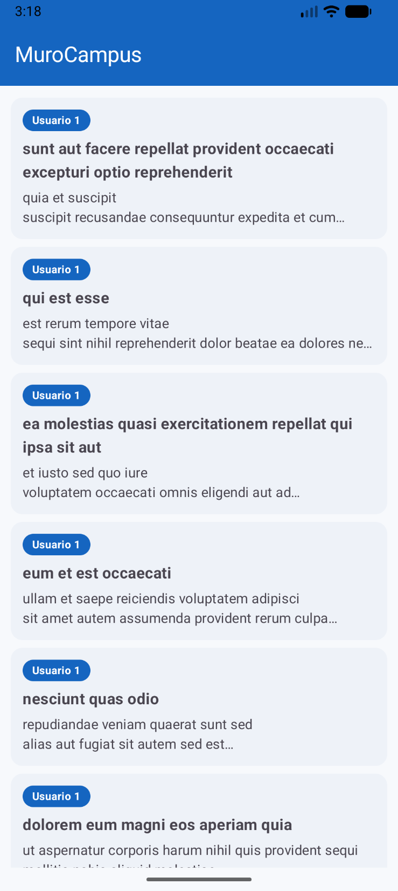
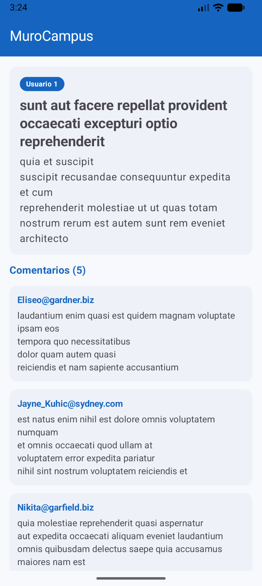
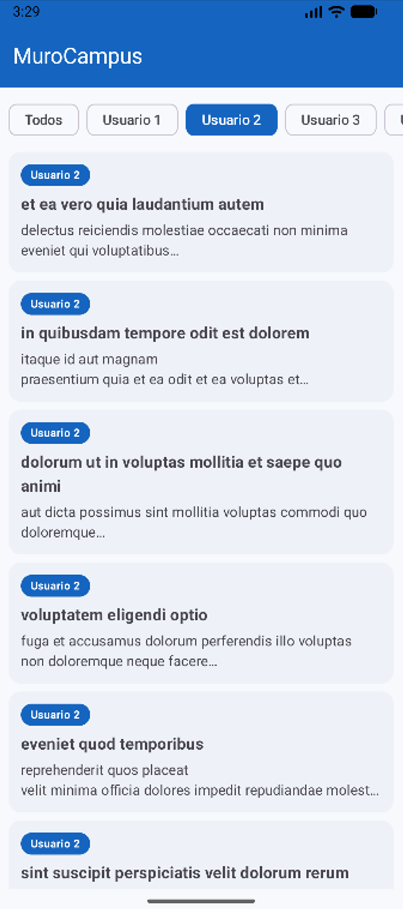
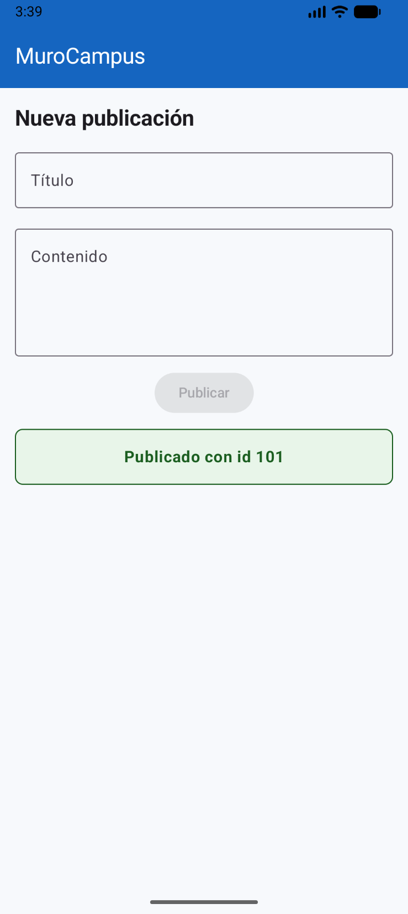
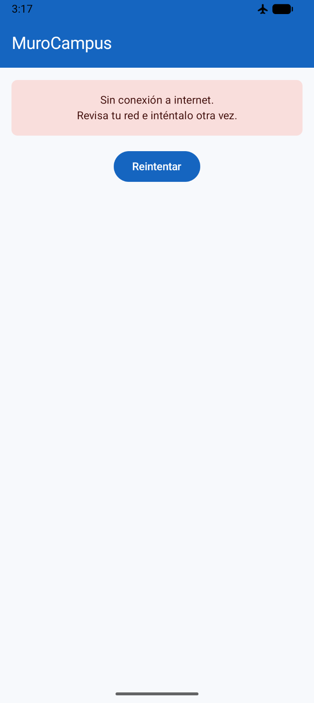

# MuroCampus

Aplicación Android que consume el servicio web REST **JSONPlaceholder**: lista publicaciones, muestra el detalle con sus comentarios, filtra por usuario y crea una publicación nueva. También se comporta bien cuando no hay internet.

**Autor:** Farid Chávez Campos
**Curso:** Programación en Móviles · 4.º ciclo · Diseño y Desarrollo de Software · TECSUP
**Laboratorio:** Semana 09 · Servicios Web y plataforma REST

---

## Tecnologías

| Tecnología | Uso |
|---|---|
| Kotlin 2.2.10 + Jetpack Compose (Material 3) | Interfaz de usuario |
| Retrofit 2.11.0 | Convierte la interface `PostApi` en llamadas HTTP |
| OkHttp 4.12.0 + Logging Interceptor | Conexión HTTP y registro del tráfico en Logcat |
| kotlinx.serialization 1.9.0 | Convierte JSON ↔ `data class` |
| ViewModel + StateFlow + Corrutinas | Estado de pantalla y llamadas asíncronas |
| Arquitectura MVVM + Repository | Separación de responsabilidades |

**API:** `https://jsonplaceholder.typicode.com/`

| Para… | Verbo y ruta |
|---|---|
| Listar publicaciones | `GET posts` |
| Ver una publicación | `GET posts/{id}` |
| Ver sus comentarios | `GET posts/{id}/comments` |
| Filtrar por usuario | `GET posts?userId=2` |
| Crear una publicación | `POST posts` con JSON en el cuerpo |

---

## Estructura de paquetes

```
com.chavez.murocampus/
├── MainActivity.kt
├── model/
│   └── Modelos.kt                 Post, Comentario, NuevoPost
├── data/
│   ├── remote/
│   │   ├── PostApi.kt             Interface de Retrofit (@GET, @POST, @Path, @Query, @Body)
│   │   └── RetrofitClient.kt      Cliente único: OkHttp + conversor JSON
│   └── PostRepository.kt          Devuelve Result<...>, nunca deja escapar excepciones
├── viewmodel/
│   ├── UiState.kt                 Cargando / Exito / Error + mensajeDe()
│   ├── PostsViewModel.kt          Estado de lista, filtro, detalle y creación
│   └── PostsViewModelFactory.kt   Crea el ViewModel con su Repository
└── ui/
    ├── Componentes.kt             TarjetaPost, IndicadorCarga, RecuadroError
    ├── PantallaLista.kt           Lista + chips de filtro
    ├── PantallaDetalle.kt         Publicación + comentarios
    ├── PantallaCrear.kt           Formulario de nueva publicación
    └── theme/
```

---

## Arquitectura MVVM + Repository

```
View (PantallaLista, PantallaDetalle, PantallaCrear)
  | eventos: cargar, filtrar, abrir, publicar      ^ collectAsStateWithLifecycle()
  v                                                |
ViewModel (PostsViewModel) --- StateFlow<UiState> (Cargando / Exito / Error) --->
  | viewModelScope.launch
  v
PostRepository (interface)      <- devuelve Result<...>
  -> PostRepositoryRemote         (captura IOException, HttpException, SerializationException)
  |
  v
PostApi (Retrofit) --- OkHttp ---> https://jsonplaceholder.typicode.com/
```

| Capa | Conoce a | No debe |
|---|---|---|
| View (`ui/`) | Solo a su ViewModel | Llamar a Retrofit ni conocer `PostApi` |
| ViewModel | Solo a la interface `PostRepository` | Conocer Retrofit, `HttpException` ni `Context` |
| Repository | `PostApi` y las excepciones de red | Conocer la UI ni dejar escapar excepciones |
| `data/remote` | Retrofit, OkHttp y el JSON | Guardar estado de pantalla |

---

## Capturas

<p align="center">
  
  
  
</p>

<p align="center">
  <b>Lista</b> &nbsp;·&nbsp; <b>Detalle con comentarios</b> &nbsp;·&nbsp; <b>Filtro por usuario</b>
</p>

<p align="center">
  
  
</p>

<p align="center">
  <b>Crear publicación</b> &nbsp;·&nbsp; <b>Error de conexión</b>
</p>

---

## Pruebas de falla

| Prueba | Cómo se provocó | Resultado | OK |
|---|---|---|---|
| Sin internet | Modo avión y abrir la app | *Sin conexión a internet* y botón Reintentar | ✅ |
| Reintentar | Desactivar el modo avión y pulsar Reintentar | Carga la lista | ✅ |
| Recurso inexistente | Pedir `posts/9999` en el detalle (temporal) | *Error del servidor (404)* | ✅ |
| JSON inesperado | Quitar un campo de `Post` que sí llega (temporal) | Funciona gracias a `ignoreUnknownKeys` | ✅ |
| JSON inesperado | Agregar a `Post` un campo que no llega (temporal) | *Respuesta inesperada* | ✅ |
| Cancelación | Abrir el detalle y volver rápido | Sin errores en Logcat | ✅ |
| Lista y detalle | Abrir varias publicaciones | Siempre 5 comentarios | ✅ |
| Filtro | Elegir cada usuario | Siempre 10 publicaciones | ✅ |
| Crear | Enviar una publicación | *Publicado con id 101* | ✅ |
| Código | Revisar `PostsViewModel` | Sin Retrofit, `PostApi` ni `HttpException` | ✅ |

---

## Para pensar

**1. ¿Qué diferencia hay entre GET y POST? ¿Por qué `crear` lleva `@Body` y `porUsuario` lleva `@Query`?**

`GET` solo **lee** un recurso y no modifica nada en el servidor: puede repetirse sin efectos secundarios. `POST` **crea** un recurso nuevo y envía datos al servidor. `crear` lleva `@Body` porque necesita mandar un objeto completo (`NuevoPost`) que Retrofit convierte en JSON dentro del cuerpo de la petición. `porUsuario` lleva `@Query` porque solo **filtra** una colección que ya existe: el dato viaja en la URL como `posts?userId=2` y no hace falta un cuerpo.

**2. ¿Por qué la ruta es `"posts"` y no `"/posts"`?**

Retrofit une la ruta con la URL base `https://jsonplaceholder.typicode.com/`. Si la ruta empieza con `/`, se interpreta como **absoluta desde la raíz del dominio** y reemplaza cualquier camino que tenga la URL base. Con esta API funcionaría igual porque la base no tiene camino, pero si la base fuera `https://servidor.com/api/v1/`, `"/posts"` apuntaría a `https://servidor.com/posts` y se perdería `/api/v1/`. Por eso la base termina en `/` y las rutas no empiezan con `/`.

**3. ¿Por qué el Repository devuelve `Result` en vez de dejar que la excepción llegue al ViewModel?**

Porque así el ViewModel no necesita conocer `IOException`, `HttpException` ni Retrofit: solo recibe éxito o fallo y lo convierte en `UiState`. `Result` obliga a manejar los dos casos, evita que una excepción no capturada cierre la app y mantiene las capas independientes: si mañana los datos vienen de Room, el ViewModel no cambia. La única excepción que el Repository relanza es `CancellationException`, para no romper la cancelación de las corrutinas.

**4. ¿Qué pasa si olvidas el permiso INTERNET? ¿Y si olvidas `ignoreUnknownKeys` y el servidor agrega un campo nuevo?**

Sin el permiso `INTERNET`, la app compila y abre, pero Android bloquea toda conexión: cada llamada falla con una excepción de red (`UnknownHostException` / `SecurityException`) y la pantalla muestra error aunque el teléfono tenga internet. Sin `ignoreUnknownKeys = true`, si el servidor agrega un campo que la `data class` no tiene, kotlinx.serialization lanza `SerializationException` y la app muestra *Respuesta inesperada*: un cambio inofensivo en el servidor rompería la app.

**5. ¿Por qué la pantalla de lista usa un `when` sobre `UiState` y no un `if` con tres variables?**

Con tres variables (`cargando`, `datos`, `error`) pueden darse combinaciones imposibles, como estar cargando y tener error a la vez, y hay que acordarse de limpiar las otras dos en cada cambio. `UiState` es una `sealed interface`: la pantalla está **exactamente en un estado** a la vez. El `when` sobre una clase sellada es exhaustivo, así que el compilador obliga a dibujar los tres casos y avisa si se agrega uno nuevo y no se maneja.

**6. JSONPlaceholder no guarda los POST. ¿Cómo cambiaría tu app si usaras un servicio real?**

Después de un `POST` exitoso, la publicación nueva sí existiría en el servidor, así que habría que **recargar la lista** o insertar el `Post` devuelto en el estado actual para que aparezca sin volver a descargar todo. También haría falta **autenticación** (un token en un `Interceptor` de OkHttp), manejar errores de validación del servidor (400, 401, 422), usar el `userId` del usuario que inició sesión en lugar de `1` fijo, y desactivar el `HttpLoggingInterceptor` en la versión de producción para no exponer datos en Logcat. Con caché en Room, el Repository decidiría si usar la red o la base de datos.